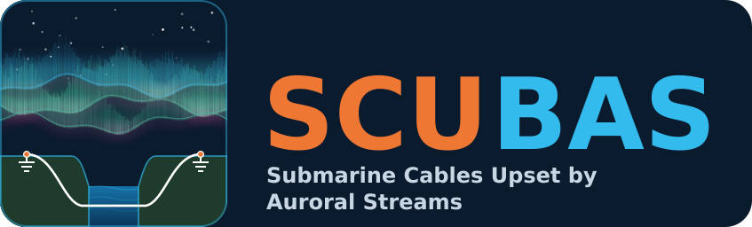

<p align="center"></p>

# SCUBAS

**S**ubmarine **C**ables **U**pset **b**y **A**uroral **S**treams.

SCUBAS estimates the **voltage induced on submarine cables by geomagnetic disturbances (space weather)**. It turns a geomagnetic record into an electric field at the
seafloor, represents each cable section as a transmission line over a layered Ocean/Earth conductivity profile, joins the sections in a nodal network, and returns the
potential along the cable and at its ends.

[](https://github.com/shibaji7/SCUBAS/actions/workflows/tests.yml)
[](https://github.com/shibaji7/SCUBAS/actions/workflows/build.yml)
[](https://github.com/shibaji7/SCUBAS/actions/workflows/docs.yml)
[](https://github.com/shibaji7/SCUBAS/actions/workflows/security.yml)
[](https://scubas.readthedocs.io/en/latest/)
[](https://pypi.org/project/scubas/)
[](https://pypi.org/project/scubas/)
[](https://codecov.io/gh/shibaji7/SCUBAS)
[](LICENSE)
[](https://github.com/pre-commit/pre-commit)
[](https://github.com/astral-sh/ruff)
[](ROADMAP.md)
[](ROADMAP.md)
[](https://github.com/shibaji7/SCUBAS/commits/main)
[](https://github.com/shibaji7/SCUBAS/issues)

> [!WARNING]
> **Development status: alpha.** SCUBAS is research software (version 0.x). Its method has been compared with observations in published studies (see
> [Citing](#citing)), but results for other cables, regions or storms are not guaranteed, and the API and the numbers may change in future versions.
> Check anything you rely on against the cited papers and your own data.

**[📖 Documentation](https://scubas.readthedocs.io/) · [📦 PyPI](https://pypi.org/project/scubas/) · [🐙 GitHub](https://github.com/shibaji7/SCUBAS) · [🐛 Issues](https://github.com/shibaji7/SCUBAS/issues) · [📜 Changelog](CHANGELOG.md) · [🗺️ Roadmap](ROADMAP.md)**

> Status: **0.1.9 (alpha)**. Implemented: the transmission-line model of Ocean/Earth sections (long and short cables), the equivalent-pi circuit and nodal solution of
> multi-section cables, active terminations, magnetic-to-electric transfer functions from IAGA-2002 or CSV records, layered profiles from LITHO1.0 (single, binned and
> Monte Carlo), and a line-current source. No further capability is committed in the [roadmap](ROADMAP.md); planned ones will be stubs in `scubas.future` that raise
> `NotImplementedYetError`.

## What it does

A storm changes the magnetic field; the Ocean/Earth conductivity structure turns that into an electric field along the cable; each section of the cable is a transmission
line whose series impedance and shunt admittance come from the layers; the sections and the land at either end are joined in one network.

```
geomagnetic record (B) -> transfer function (E2B) -> electric field (E) -> equivalent-pi sections -> nodal network -> potentials along and at the ends of the cable
```

The theory is in the [documentation](https://scubas.readthedocs.io/): thin-sheet and transmission-line modelling, electrically long and short cables, active terminations,
network modelling, and the March 1989 TAT-8 event as a case study.

## Install

```bash
pip install scubas
```

Python >= 3.11 (pandas 2 or 3). The extras `scubas[plots]`, `scubas[data]`, `scubas[docs]` and `scubas[dev]` exist; `plots` and `data` repeat dependencies that are already required, and `scubas.__version__` gives the version. From a clone, for development:

```bash
git clone https://github.com/shibaji7/SCUBAS && cd SCUBAS
make env && conda activate scubas   # conda environment from environment.yml (or any Python >= 3.11)
make dev            # editable install with pytest, coverage, ruff, pre-commit, build, twine
make qa             # everything that must pass before a commit
```

## Quick start

```python
import pandas as pd

from scubas.cables import Cable, TransmissionLine
from scubas.datasets import PROFILES

# one hour of a constant 100 mV/km north-south geoelectric field, sampled each minute
time = pd.date_range("2024-05-10 00:00", periods=60, freq="min", name="Time")
efield = pd.DataFrame({"X": [100.0] * 60}, index=time)

# a 1000 km section of deep ocean
section = TransmissionLine(
    "deep-ocean",
    directed_length={"length_north": 1000.0},
    elec_params={"site": PROFILES.DO},
)
section.compute_eqv_pi_circuit(Efield=efield, components=["X"])

cable = Cable([section], components=["X"])
print(cable.tot_params[["U0", "U1", "Vt(v)"]].iloc[0])   # potentials at the two ends, in volts
```

To drive the cable from magnetometer data instead of a given field, attach B-field files and let `compile_oml` compute the electric field:
`section.compile_oml(bfield_data_files=["examples/datasets/1989/FRD.csv"], csv_file_date_name="Date")`. The scripts in `examples/` reproduce the figures of the tutorials.

## Inputs and outputs

| | |
|---|---|
| **Magnetic field** | IAGA-2002 `.txt` / `.min` files, or CSV with a `Date` column and `X, Y, Z, F` (gaps are filled by spline interpolation) |
| **Earth model** | the ready-made profiles in `scubas.datasets.PROFILES` (continental shelf, shallow and deep ocean, land, the TAT-8 sections), or layered profiles from LITHO1.0 (`scubas.conductivity`, downloaded on first use; see [SECURITY.md](SECURITY.md)) |
| **Result** | `Cable.tot_params` (a DataFrame: section fields, section potentials, end potentials `U0`, `U1`, total `Vt(v)`), and `Cable.save(folder)` writes `est_cable_props.json` and `sim-params.csv` |

## Compatible by design

SCUBAS 0.1.9 is on PyPI and cited in papers, so its public API, file formats and numbers are pinned by the compatibility suite in `tests/compat/`. New standards (lint, headers,
docs, tests) apply to new and touched code without rewriting working science code; known defects are recorded as they are, not fixed silently. See the
[decision records](https://scubas.readthedocs.io/en/latest/dev/adr/).

## Layout

| Path | What |
|---|---|
| `scubas/cables.py` | `CableSection`, `TransmissionLine`, `Cable`: geometry, line parameters, equivalent-pi circuit, nodal analysis |
| `scubas/models.py`, `scubas/datasets.py`, `scubas/conductivity.py` | transfer functions and B-field readers, layered Earth profiles, LITHO1.0 profiles |
| `scubas/sources/`, `scubas/plotlib.py`, `scubas/utils.py` | line-current source, figures, FFT and distance helpers |
| `scubas/future/`, `scubas/errors.py` | planned capabilities as stubs (empty until one is named) and their error type |
| `tests/` | the compatibility suite (`tests/compat/`) and the unit tests |
| `docs/` | the documentation (Sphinx and MyST, Read the Docs) |
| `examples/` | the scripts that make the tutorial figures, and the 1989 data |

## Develop

`make help` lists everything: `test`, `cov`, `lint`, `format`, `docs`, `qa`, `compat-baseline`. See [CONTRIBUTING.md](CONTRIBUTING.md) for the git workflow (pull requests to `main`, squash
merge, a green CI), [ROADMAP.md](ROADMAP.md) and [SECURITY.md](SECURITY.md).

## Citing

If SCUBAS contributes to a project that leads to a publication, please cite (see also `CITATION.cff`):

- Chakraborty S, Boteler DH, Shi X, Murphy BS, Hartinger MD, Wang X, Lucas G and Baker JBH (2022) Modeling geomagnetic induction in submarine cables. *Front. Phys.* 10:1022475. [doi:10.3389/fphy.2022.1022475](https://doi.org/10.3389/fphy.2022.1022475)

Published studies that use SCUBAS are listed in the [documentation](https://scubas.readthedocs.io/en/latest/user/citing/).

## License

SCUBAS is licensed under the **GNU Lesser General Public License v3.0 or later** (`LGPL-3.0-or-later`, see `LICENSE` and `COPYING`). Releases up to and including 0.1.9 were published under the MIT
license and remain available under it; see `NOTICE.md`.
